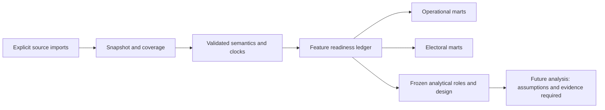

# Feature and readiness contract

Document-ID: EA-FEATURE-READINESS · Revision: 3 · Language: en

[Português](../pt-BR/feature-readiness.md)

The normative [feature registry](../../election_audit/resources/contracts/features.json)
assigns each planned mart/target a grain, required input IDs, exact denominator,
analytical role, definition and explicit blockers. It is a design inventory, not
computed features or a claim that any input is ready. The English
[research protocol](../../research/analysis-plan.md) and its full
[Portuguese translation](../../research/analysis-plan.pt-BR.md) retain the design,
assumptions and caveats. There is no model fitting or fraud labeling here; the
`features` module (Phase 14) materializes this registry into feature releases.

Every requested unit remains in a feature/readiness ledger, including exclusions.
Use `not_evaluated`, `ready`, `partial`, `unavailable`, `not_applicable`; preserve
value, unit, numerator, denominator, reason/details, snapshot, unit key, feature ID,
specification version, role and original-record lineage. A missing or zero
numerator is different from an unknown or zero denominator. Unknown values are
null with a reason, never filled with zero. `ready` requires validated semantics,
source completeness for that feature and a positive valid denominator where a
ratio is defined. A count can be valid zero; a ratio with zero denominator is
undefined. Partial data keep counts of eligible, excluded and unresolved units.

Input IDs and blockers are versioned in the registry. Logs alone cannot supply
candidate counts, electorate, pre-election covariates or final national margin.
Package lifecycle timestamps can be available without importing BUs; their
semantics still require evidence. Other rounds and 2022/2018 history require
explicit imports and validated harmonization. Availability for a UF subset (such
as the current AC feature release) is partial national coverage; no national
inference follows from it.

| Feature / mart / target | Required input IDs | Denominator / interpretation |
| --- | --- | --- |
| `population_coverage` | `freeze`, `composition`, `logs`, `locations` | Expected registered sections; distinct principal count reported separately. Expected/member/principal/installed/not_installed/log/BU/parsed/reconciled/excluded counts; publish unknown strata |
| `session_summary` | `freeze`, `sessions` | Unique reconstructed sessions; completed cycles for rates. Completed/suspended/cancelled/unresolved cycles; manual requests vs completed manual cycles; restarts/outages; selection uncertainty |
| `cycle_duration_gap` | `freeze`, `sessions`, `clocks` | Completed cycles with valid start/end; within-session adjacent valid cycles for gaps. Duration/gap distribution with eligible pair counts; failed authorization per known attempt; outages and within-day intensity per observed exposure seconds |
| `processing_event_availability` | `freeze`, `processing` | Expected packages/results in declared status population, not number of observed timestamps. Separate availability for receipt, processing, generation and publication; missing is not zero latency |
| `late_voting` | `freeze`, `sessions`, `clocks`, `composition` | Completed cycles with classifiable completion instants; separately all completed and unresolved cycles. Domestic after17 means completion strictly after 17:00:00 America/Sao_Paulo (Brasilia) on target election date; equal boundary not after. Overseas separately with local convention; never candidate attribution. Store counts, share, last completion, and clock-bound sensitivity |
| `section_results` | `freeze`, `bu2`, `composition` | Eligible electorate for turnout; all presidential ballots for blank/null; candidate votes for valid share. One canonical eligible totalized result; totals one row per result, long choices separately; reconcile every category |
| `unanimous_results` | `freeze`, `bu2`, `composition` | Canonical resolved principal results with total_presidential_ballots > 0; separately counts unavailable. Strict unanimity: one candidate has total_presidential_ballots, all other choices zero, blank/null/special/unresolved zero and complete. All-valid-only unanimity is a different separately named statistic |
| `result_timing` | `freeze`, `bu2`, `processing`, `clocks` | Results with both specified event instants known; report missing/out-of-order counts separately. Keep receipt, processing, generation, publication, client observation distinct; compute explicitly named intervals without overwriting negative/corrected values; distinguish closing-to-receipt from receipt-to-publication |
| `round_comparison` | `freeze`, `bu1`, `bu2`, `composition`, `locations` | Matched/harmonized electorate or candidate-only valid votes separately for each round. Preference vector and turnout differences on equivalent aggregation; candidate IDs/contest counts explicit, changed electorates/transfers retained. No individual vote-transfer inference |
| `audit_features` | `freeze`, `design` | Feature-specific denominator and availability, never generic zero imputation. Long feature ledger includes value, unit, numerator, denominator, status/reason, source keys, transformation version, role and mechanism-specification membership |
| `turnout_target` | `freeze`, `bu2`, `composition`, `design` | Eligible electors > 0 in same population. attending_voters / eligible_electors; validated log completions are corroboration, not automatic replacement of official attendance |
| `candidate_share_target` | `freeze`, `bu2`, `composition`, `design` | A + B > 0; all other candidate categories explicitly reconciled. A / (A + B); A/B fixed from official candidacy IDs and evaluated symmetrically |
| `blank_null_targets` | `freeze`, `bu2`, `composition`, `design` | total_presidential_ballots > 0 including all applicable categories. Separate blank and applicable null proportions; exceptional categories separately identified, not silently merged |
| `peer_covariates` | `freeze`, `bu1`, `composition`, `locations`, `history`, `pre_election`, `design` | Comparable population/overlap; source observation dates for covariates. Electorate/size, first-round vector, geography, comparable history, pre-election polling-place characteristics, contest count; current-cycle-only/no-first-round sensitivity variants |
| `device_logistics` | `freeze`, `sessions`, `pre_election`, `design` | Known hardware/software/logistics exposure and observed sessions. Model/version/logistics adjust one operational specification and are possible mechanisms in another; turnout/manual/outages remain outcomes/exposures when hypothesized effects |
| `integrity` | `freeze`, `bu2`, `composition`, `final`, `sessions`, `rdv_signatures` | Same coherent principal population and canonical versions at every hierarchy. Accounting and BR/UF/municipality incl ZZ checks; targeted RDV recount/signatures; distinguish publication gaps, numerical disagreement and independent corroboration |
| `conditional_unusualness` | `freeze`, `design`, `calibration`, `validation` | Eligible held-out peers/calibration clusters; record n_cal and overlap. Matched empirical median/quantiles/MAD and quantile regression forest compared by held-out quantile loss/coverage; signed residuals plus prespecified joint maximum score with trained scale floors |
| `multiplicity` | `freeze`, `design`, `calibration`, `validation` | Full prespecified tested family incl null results; valid p-values required. Whole-location splits/seeds/geographic strata; municipality stress tests; dependence-aware BY at proposed 5% FDR; retain adaptive/exploratory ledger and test-set access history |
| `validation_investigation` | `freeze`, `design`, `validation`, `corroboration` | All simulated cases plus random unflagged sample; stratum coverage. Independent validation copies for additions/switches/turnout reduction/duplicates/missing blocks/clock errors; power/localization/benign false alarms; initially candidate-blinded log review where feasible |
| `conditional_margin_bounds` | `freeze`, `bu2`, `final`, `sessions`, `mechanism` | r completed presidential ballots with 0 <= r <= a + b + c; validated q_i caps; reconciled M. Anonymous-removal sharp bounds; at-most-r includes zero; switching cap 2 * min(q_i, a_i); strict-win thresholds floor(M/2) + 1 or M + 1; no allocation of anonymous cycles to candidates |
| `counterfactual_excess` | `freeze`, `bu2`, `final`, `design`, `calibration`, `validation`, `mechanism` | n_valid_i with fixed valid turnout; absent-voter preference assumptions separate. Excess relative to baseline: 2 * sum(a_i - n_valid_i * p_hat_i); full fit/selection pipeline geographic block resampling and sensitivity; signed effects not stolen votes |

The registry's `unavailable_when` is feature-specific. In particular, unresolved
clock conversion blocks absolute-time analyses; missing first-round composition
blocks round comparison; conflicting canonical results block electoral counts;
unsupported exchangeability blocks inferential p-values while permitting clearly
labeled descriptive ranks. Missing independent corroboration leaves fraud and
causal impact unidentified, even when statistical features can be computed.

Strict unanimity requires `total_presidential_ballots > 0`, complete choice counts,
exactly one candidate with every ballot, and zero blank/null/special/unresolved
categories. “All valid candidate votes” is a different statistic and must have a
separate name/denominator. Domestic after17 uses completion strictly after
`17:00:00` Brasilia (`America/Sao_Paulo`) on target date; equality is not after17.
Report overseas separately and preserve clock sensitivity. Late/manual/fast cycles
are anonymous; never join them to candidate choices or shuffled RDV row order.

Analytical roles are `outcome`, `context`, `sensitivity`, `diagnostic`. Later
specifications may add a documented exposure role. Device/version/logistics can
adjust one operational specification and represent possible mechanisms in another.
Turnout, manual authorization and outages must not automatically become controls
when they are the hypothesized effects. Preserve no-first-round and
historical-assisted/current-cycle-only sensitivity specifications. Do not use
post-outcome measurements as pre-election predictors.

The three protocol questions map to `integrity`, `conditional_unusualness`, and
`conditional_margin_bounds` / `counterfactual_excess`. The last two remain
conditional on mechanism/counterfactual evidence and a coherent final population.
Whole-location splits, geographic stress tests, untouched-test access history,
all explored outcomes/subgroups/windows/models, multiplicity families and power
resolution belong in the future analysis ledger. Sequential monitoring is
currently descriptive. Simulated power cannot certify detection of all fraud;
source agreement cannot establish independent voter intent.

No arrow in this diagram implements fitting. Source acquisition, reconstruction,
publication and analysis are separate stages. `docs-check` covers pairing,
revisions, local links and identical code examples, and `docs-command-check` checks
documented commands against real `--help` output; Mermaid diagrams preserve
structure and IDs while human labels are translated.
