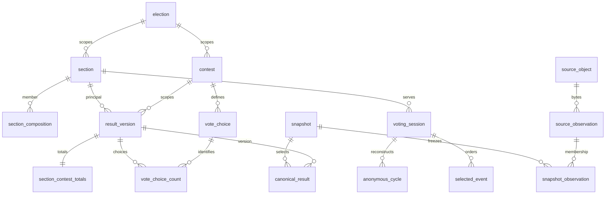

# Schema dictionary

Document-ID: EA-SCHEMA-DICTIONARY · Revision: 2 · Language: en

[Português](../pt-BR/schema-dictionary.md)

This is a design contract, not populated tables or an ETL implementation. The
normative machine-readable field dictionary is [schema.json](../../election_audit/resources/contracts/schema.json)
(`contract_version` = `1.0.0`). Each field declares type, nullability and meaning;
each table declares grain, primary/unique keys, foreign keys and semantic rules.
Future DuckDB/Parquet publishers must validate these constraints explicitly:
Parquet alone does not enforce relational keys. [Conventions](transformation-conventions.md)
complete this contract. [Readiness](feature-readiness.md) governs analytical use.

| Family / tables | Grain and relationships |
| --- | --- |
| `source_object` | One SHA-256-addressed exact byte sequence; never one URL. |
| `source_observation` | One immutable URL observation attempt per run; many observations may reference the same object; failures retain null object and reason. Official and retrieval URLs remain separate. |
| `source_package` | One official package identifier within an election-scoped section; package ID is not our content digest. |
| `package_observation` / `package_asset` | One package advertisement per metadata observation; one advertised filename within that advertisement. Status changes append observations. |
| `snapshot` / `snapshot_observation` | One immutable inventory/policy/contract version; unique membership links to frozen URL-to-object observations. Latest manifest mappings do not establish historical provenance. |
| `election` / `contest` | Election identity includes year, pleito, official election and round; cargo and jurisdiction identify a contest within it. |
| `section` / `location` | Registered section and polling place scoped to election/UF/TSE municipality/zone. Section identities include members; location assignment is snapshot-dependent. Never infer IBGE mapping. |
| `section_composition` | Exactly one terminal principal per member per snapshot; principal maps to itself. Same election, no chains/cycles. Many members may map to one principal; this does not duplicate principal ballots. |
| `harmonized_population` / `harmonized_member` | One versioned disjoint common comparison population; one whole principal membership per source snapshot. Aggregate each round separately before comparing. Same-policy populations must not overlap; unprovable splits/transfers stay incomparable, with no invented allocation weights. |
| `candidacy` / `vote_choice` | Candidacy belongs to a contest; choice distinguishes candidate, blank, null, special and unresolved categories. Only candidate choices reference a candidacy in that same contest. Names/ballot numbers are not cross-election person identity. |
| `physical_device` / `software_configuration` | Hardware identity requires serial evidence; unknown hardware is not merged by model. Software/build/configuration is a separate identity, not a package, section or session. |
| `processing_event` | One evidenced receipt/processing/generation/publication/observation event or explicit missing field per package/result observation. Repeated corrections remain distinct; package events do not require a BU import. Preserve raw time, availability, conversion evidence and confidence. |
| `result_version` | One immutable principal-section/contest result version; competing, decreasing and rejected results remain preserved. |
| `section_contest_totals` | Exactly one totals row per result version. Electorate, attendance and category totals do not repeat per candidate. |
| `vote_choice_count` | One choice count per result version; must match result contest. Missing row is not automatically zero. |
| `canonical_result` | One selection decision per snapshot/principal/contest. Only an eligible totalized target-phase version can be selected. Missing/ineligible/conflicting decisions keep a null result with reason. Never sum all packages/hashes. |
| `voting_session` / `session_package` | One reconstructed physical session per reconstruction version; a session can have multiple package witnesses and a principal can have replacement sessions. Evidence link is many-to-many, never a vote aggregation route. |
| `selected_event` | One original ordered event in a reconstructed session, with target-selection decision, original clock, conversion rule/offset/adjustment and confidence. Mixed-round excluded events retain reasons. |
| `anonymous_cycle` | One reconstructed anonymous cycle within session; completion/authorization/uncertainty separated. No candidacy, ballot choice, RDV row or voter identity exists in this table. |
| `coverage_ledger` | One expected registered section per snapshot, including members, missing, non-installed, excluded and failed records. Principal coverage has its own distinct denominator. |
| `record_lineage` | One derived-row/original-record contribution, retaining object digest, observation, nested archive/member occurrence and original line/byte/record ranges plus transformation version. |
| `parsing_issue` | One issue anchored to original bytes, even when normalization fails; keep reason/uncertainty without unnecessary sensitive tokens. |

Identifiers are non-null text; original codes remain zero-padded text, counts use
64-bit integers. All nullable fields remain present and require an entry in the
row's `field_states` object. Reasons are `missing_source`, `not_published`,
`not_applicable`, `unresolved`, `conflict`, `parse_error`, `unknown`. Preserve source
missing-value tokens in lineage/controlled source evidence. Numerical zero means
observed zero; unknown is never coerced to zero. `instant` requires an explicit
offset and is published as UTC; naive readings remain text. Source receipt,
processing, artifact generation, publication, client observation and snapshot
creation are separate timestamps. Their order can be corrected or contradictory;
retain evidence and flag it rather than fabricate an order.

A source field with uncertain semantics must stay unresolved, with a parsing
issue, until its schema is validated. The registry supplies structural fields;
source-specific enum mappings, code widths and exceptional BU categories require
validated parser/import adapters in later phases.



The diagram omits optionality/compound keys for readability; the JSON is normative.
The session/section edge does not mean every session has a resolved section.
The APIs `load_contract`, `validate_contracts` and `validate_rows` in
[contracts.py](../../election_audit/contracts.py) validate registry references and
single-table shape/types/keys/null reasons. They do not certify semantic evidence,
foreign rows, nonnegative counts, canonical eligibility or accounting. Later
publication must run the relational/semantic checks in the conventions.

```sh
rtk proxy env UV_CACHE_DIR=/tmp/election-audit-uv-cache UV_OFFLINE=1 uv run --locked python -m election_audit.contracts
```
