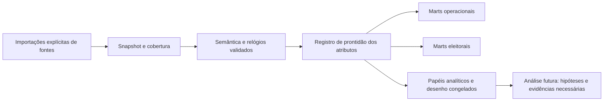

# Contrato de atributos e prontidão

Document-ID: EA-FEATURE-READINESS · Revision: 3 · Language: pt-BR

[English](../en/feature-readiness.md)

O [registro de atributos](../../election_audit/resources/contracts/features.json) normativo
atribui a cada mart/alvo granularidade, IDs de entradas necessárias, denominador
exato, papel analítico, definição e bloqueios explícitos. É inventário de projeto,
não atributos calculados nem declaração de prontidão. O
[protocolo em inglês](../../research/analysis-plan.md) e sua
[tradução integral](../../research/analysis-plan.pt-BR.md) mantêm desenho, hipóteses
e ressalvas. Não há ajuste de modelos nem rótulos de fraude aqui; o módulo
`features` (Fase 14) materializa este registro em releases de features.

Toda unidade solicitada permanece no registro de atributos/prontidão, inclusive
excluídas. Use `not_evaluated`, `ready`, `partial`, `unavailable`, `not_applicable`;
preserve valor, unidade, numerador, denominador, motivo/detalhes, snapshot, chave
da unidade, ID do atributo, versão da especificação, papel e linhagem original.
Numerador ausente ou zero difere de denominador desconhecido ou zero. Valores
desconhecidos são nulos com motivo, nunca preenchidos com zero. `ready` exige
semântica validada, completude necessária àquele atributo e denominador válido
positivo quando há razão. Contagem pode ser zero válido; razão com denominador
zero é indefinida. Dados parciais mantêm contagens elegíveis, excluídas e não resolvidas.

IDs de entrada e bloqueios são versionados no registro. Logs não fornecem contagens
por candidato, eleitorado, covariáveis pré-eleitorais ou margem nacional final.
Horários do ciclo de pacote podem existir sem importar BUs; sua semântica ainda
exige evidência. Outros turnos e histórico 2022/2018 exigem importações explícitas
e harmonização validada. Disponibilidade em um subconjunto de UFs (como a release
atual de features do AC) é cobertura nacional parcial; não permite inferência nacional.

| Atributo / mart / alvo | IDs de entradas necessárias | Denominador / interpretação |
| --- | --- | --- |
| `population_coverage` | `freeze`, `composition`, `logs`, `locations` | Seções registradas esperadas; principais distintas informadas separadamente. Contagens esperadas/integrantes/principais/instaladas/não instaladas/log/BU/parsing/reconciliadas/excluídas; publicar estratos desconhecidos. |
| `session_summary` | `freeze`, `sessions` | Sessões reconstruídas únicas; ciclos completos nas taxas. Separar completos/suspensos/cancelados/não resolvidos, pedidos manuais de ciclos manuais concluídos, reinícios/interrupções e incerteza. |
| `cycle_duration_gap` | `freeze`, `sessions`, `clocks` | Ciclos completos com início/fim válidos; pares adjacentes válidos nos intervalos. Distribuições com contagem de pares; falhas por tentativas conhecidas; intensidade por segundos observados. |
| `processing_event_availability` | `freeze`, `processing` | Pacotes/resultados esperados na população de estado declarado, não quantidade de horários observados. Disponibilidade separada de recebimento, processamento, geração e publicação; ausência não é latência zero. |
| `late_voting` | `freeze`, `sessions`, `clocks`, `composition` | Ciclos completos com instantes classificáveis; informar também todos os completos e não resolvidos. Doméstico: conclusão estritamente após 17:00:00 Brasília na data alvo; igualdade não conta. Exterior separado, sem atribuição a candidato. Contagens, proporção, última conclusão e sensibilidade. |
| `section_results` | `freeze`, `bu2`, `composition` | Eleitorado apto no comparecimento; todos os votos presidenciais em brancos/nulos; votos de candidatos na proporção válida. Um resultado totalizado canônico elegível, totais em linha única e escolhas separadas; reconciliar categorias. |
| `unanimous_results` | `freeze`, `bu2`, `composition` | Resultados principais canônicos resolvidos com total_presidential_ballots > 0; contar indisponíveis separadamente. Um candidato tem todos os votos, demais escolhas zero, brancos/nulos/especiais/não resolvidos zero e completude. Unanimidade apenas dos válidos é outro indicador. |
| `result_timing` | `freeze`, `bu2`, `processing`, `clocks` | Resultados com ambos os instantes especificados conhecidos; informar ausentes/fora de ordem. Separar recebimento/processamento/geração/publicação/observação, nomear intervalos e preservar negativos/correções; fechamento-recebimento difere de recebimento-publicação. |
| `round_comparison` | `freeze`, `bu1`, `bu2`, `composition`, `locations` | Eleitorado harmonizado ou votos válidos só de candidatos, separadamente por turno. Vetor de preferência e diferenças de comparecimento em agregação equivalente; IDs/número de disputas e transferências explícitos. Sem transferência individual inferida. |
| `audit_features` | `freeze`, `design` | Denominador e disponibilidade próprios do atributo; nunca imputação genérica zero. Registro longo com valor, unidade, numerador, denominador, estado/motivo, fontes, transformação, papel e especificação de mecanismo. |
| `turnout_target` | `freeze`, `bu2`, `composition`, `design` | Eleitores aptos > 0 na mesma população. attending_voters / eligible_electors; conclusões de log validadas corroboram, não substituem automaticamente comparecimento oficial. |
| `candidate_share_target` | `freeze`, `bu2`, `composition`, `design` | A + B > 0; demais categorias de candidatos reconciliadas explicitamente. A / (A + B); A/B fixados por IDs oficiais, avaliados simetricamente. |
| `blank_null_targets` | `freeze`, `bu2`, `composition`, `design` | Total_presidential_ballots > 0 com todas as categorias aplicáveis. Proporções separadas de branco e nulo aplicável; excepcionais identificados à parte. |
| `peer_covariates` | `freeze`, `bu1`, `composition`, `locations`, `history`, `pre_election`, `design` | População comparável/sobreposição e datas de observação. Eleitorado/tamanho, vetor do primeiro turno, geografia, histórico comparável, características prévias do local, número de disputas; variantes só do ciclo atual e sem primeiro turno. |
| `device_logistics` | `freeze`, `sessions`, `pre_election`, `design` | Exposição conhecida a hardware/software/logística e sessões observadas. Ajustam uma especificação e representam mecanismos em outra; comparecimento/manual/interrupções mantêm papel de efeito/exposição se assim hipotetizados. |
| `integrity` | `freeze`, `bu2`, `composition`, `final`, `sessions`, `rdv_signatures` | Mesma população principal coerente e versões canônicas em toda hierarquia. Contabilidade e BR/UF/município com ZZ; RDV/assinaturas direcionados; separar lacunas, discrepâncias e confirmação independente. |
| `conditional_unusualness` | `freeze`, `design`, `calibration`, `validation` | Pares reservados elegíveis/agrupamentos de calibração; registrar n_cal e sobreposição. Referência empírica pareada e floresta comparadas por perda quantílica/cobertura; resíduos com sinal e máximo conjunto com pisos aprendidos. |
| `multiplicity` | `freeze`, `design`, `calibration`, `validation` | Família completa pré-especificada incluindo nulos; exige p-valores válidos. Divisões por local/sementes/estratos; estresse municipal; BY dependente com FDR proposto 5%; registrar exploração/adaptação e acesso ao teste. |
| `validation_investigation` | `freeze`, `design`, `validation`, `corroboration` | Todos os casos simulados e amostra aleatória de não sinalizados; cobertura por estrato. Cópias para adições/trocas/redução de comparecimento/duplicações/segmentos ausentes/erros de relógio; poder/localização/alarmes benignos; revisão inicial sem candidato quando possível. |
| `conditional_margin_bounds` | `freeze`, `bu2`, `final`, `sessions`, `mechanism` | r votos presidenciais completos com 0 <= r <= a + b + c; limites q_i validados; M reconciliado. Limites exatos de remoção anônima; no-máximo-r inclui zero; troca 2 * min(q_i, a_i); vitória estrita floor(M/2) + 1 ou M + 1; sem alocar ciclos a candidatos. |
| `counterfactual_excess` | `freeze`, `bu2`, `final`, `design`, `calibration`, `validation`, `mechanism` | n_valid_i com comparecimento válido fixo; hipóteses sobre ausentes separadas. Excesso relativo à referência: 2 * sum(a_i - n_valid_i * p_hat_i); reamostragem geográfica de todo ajuste/seleção e sensibilidade; efeito com sinal não é voto roubado. |

`unavailable_when` no registro é específico de cada atributo. Conversão de relógio
não resolvida bloqueia análises absolutas; composição de primeiro turno ausente
bloqueia comparação; resultados canônicos conflitantes bloqueiam contagens;
permutabilidade sem suporte bloqueia p-valores inferenciais, permitindo postos
claramente descritivos. Sem confirmação independente, fraude e impacto causal
permanecem não identificados, mesmo se atributos estatísticos forem calculáveis.

Unanimidade estrita exige `total_presidential_ballots > 0`, escolhas completas,
exatamente um candidato com todos os votos e zero brancos/nulos/especiais/não
resolvidos. “Todos os votos válidos de candidatos” é outro indicador, com nome e
denominador separados. after17 doméstico usa conclusão estritamente após
`17:00:00` Brasília (`America/Sao_Paulo`) na data alvo; igualdade não conta.
Exterior deve ser separado, com sensibilidade de relógio. Ciclos tardios/manuais/
rápidos são anônimos; nunca uni-los às escolhas ou à ordem embaralhada do RDV.

Papéis analíticos são `outcome`, `context`, `sensitivity`, `diagnostic`. Especificações
posteriores podem acrescentar papel documentado de exposição. Modelo/versão/
logística podem ajustar uma especificação operacional e representar mecanismos
em outra. Comparecimento, autorização manual e interrupções não viram controles
automaticamente se forem efeitos hipotéticos. Preserve variantes sem primeiro
turno e com histórico/só ciclo atual. Não use medidas pós-desfecho como preditores
pré-eleitorais.

As três perguntas do protocolo correspondem a `integrity`, `conditional_unusualness`
e `conditional_margin_bounds` / `counterfactual_excess`. As últimas permanecem
condicionadas à evidência de mecanismo/contrafactual e população final coerente.
Divisões por local, estresse geográfico, histórico de acesso ao teste intocado,
todos os desfechos/subgrupos/janelas/modelos explorados, famílias de multiplicidade
e resolução de poder pertencem ao futuro registro de análise. Monitoramento
sequencial é atualmente descritivo. Poder simulado não certifica detecção de toda
fraude; concordância de fontes não estabelece intenção independente do eleitor.

Nenhuma seta implementa ajuste. Aquisição, reconstrução, publicação e análise são
estágios separados. `docs-check` cobre pares, revisões, links locais e exemplos em
blocos de código idênticos, e `docs-command-check` confere os comandos documentados
com a saída real de `--help`; diagramas Mermaid mantêm estrutura e identificadores,
com rótulos humanos traduzidos.
