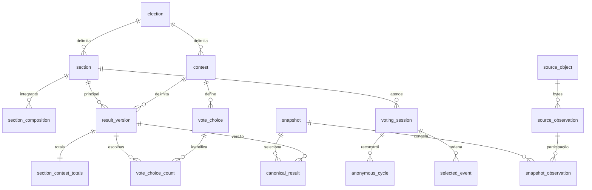

# Dicionário do esquema

Document-ID: EA-SCHEMA-DICTIONARY · Revision: 3 · Language: pt-BR

[English](../en/schema-dictionary.md)

Este é um contrato de projeto, não tabelas preenchidas nem implementação de ETL.
O dicionário normativo de campos, legível por máquina, é [schema.json](../../election_audit/resources/contracts/schema.json)
(`contract_version` = `1.0.0`). Cada campo declara tipo, nulabilidade e significado;
cada tabela declara granularidade, chaves primária/únicas, estrangeiras e regras
semânticas. Publicadores futuros de DuckDB/Parquet devem verificar essas restrições
explicitamente: Parquet sozinho não impõe chaves relacionais. As
[convenções](transformation-conventions.md) completam este contrato. A
[prontidão](feature-readiness.md) rege o uso analítico.

| Família / tabelas | Granularidade e relações |
| --- | --- |
| `source_object` | Uma sequência exata de bytes endereçada por SHA-256; nunca uma URL. |
| `source_observation` | Uma tentativa imutável de observar uma URL por execução; várias observações podem referenciar o mesmo objeto; falhas mantêm objeto nulo e motivo. URLs oficial e de recuperação permanecem separadas. |
| `source_package` | Um identificador oficial de pacote em uma seção delimitada pela eleição; o ID do pacote não é nosso resumo de conteúdo. |
| `package_observation` / `package_asset` | Um anúncio de pacote por observação de metadados; um nome de arquivo anunciado dentro desse anúncio. Mudanças de estado acrescentam observações. |
| `snapshot` / `snapshot_observation` | Um inventário/política/versão de contrato imutável; vínculos únicos com observações congeladas de URL para objeto. Mapeamentos atuais do manifesto não estabelecem proveniência histórica. |
| `election` / `contest` | A identidade eleitoral inclui ano, pleito, eleição oficial e turno; cargo e jurisdição identificam uma disputa dentro dela. |
| `section` / `location` | Seção registrada e local de votação delimitados por eleição/UF/município TSE/zona. As identidades de seção incluem agregadas; a atribuição de local depende do snapshot. Nunca inferir o mapeamento IBGE. |
| `section_composition` | Exatamente uma principal terminal por integrante por snapshot; a principal aponta para si. Mesma eleição, sem cadeias/ciclos. Várias integrantes podem apontar para uma principal; isso não duplica seus votos. |
| `harmonized_population` / `harmonized_member` | Uma população comum disjunta versionada para comparação; uma principal inteira por snapshot de origem. Agregar cada turno separadamente antes de comparar. Populações da mesma política não se sobrepõem; divisões/transferências sem prova ficam incomparáveis, sem pesos de alocação inventados. |
| `candidacy` / `vote_choice` | Candidatura pertence a uma disputa; escolha distingue candidato, branco, nulo, especial e não resolvido. Só escolhas de candidato referenciam candidatura da mesma disputa. Nomes/números não identificam uma pessoa entre eleições. |
| `physical_device` / `software_configuration` | Identidade física exige evidência de série; hardware desconhecido não é unido por modelo. Software/build/configuração tem identidade separada de pacote, seção ou sessão. |
| `processing_event` | Um evento comprovado de recebimento/processamento/geração/publicação/observação ou campo explicitamente ausente por observação de pacote/resultado. Correções repetidas permanecem distintas; eventos de pacote não exigem importação de BU. Preserve horário bruto, disponibilidade, evidência de conversão e confiança. |
| `result_version` | Uma versão imutável de resultado por seção principal/disputa; resultados concorrentes, decrescentes e rejeitados permanecem preservados. |
| `section_contest_totals` | Exatamente uma linha de totais por versão de resultado. Eleitorado, comparecimento e totais de categorias não se repetem por candidato. |
| `vote_choice_count` | Uma contagem de escolha por versão; deve corresponder à disputa do resultado. Linha ausente não significa automaticamente zero. |
| `canonical_result` | Uma decisão de seleção por snapshot/principal/disputa. Só versão elegível totalizada da fase oficial alvo pode ser selecionada. Decisões ausentes/inelegíveis/conflitantes mantêm resultado nulo e motivo. Nunca somar todos os pacotes/hashes. |
| `voting_session` / `session_package` | Uma sessão física reconstruída por versão de reconstrução; pode ter vários pacotes como evidência e uma principal pode ter sessões de substituição. O vínculo é muitos-para-muitos, nunca caminho de agregação de votos. |
| `selected_event` | Um evento original ordenado em uma sessão reconstruída, com decisão de seleção, relógio original, regra de conversão/deslocamento/ajuste e confiança. Eventos excluídos de outros turnos mantêm o motivo. |
| `anonymous_cycle` | Um ciclo anônimo reconstruído por sessão; conclusão/autorização/incerteza separadas. Não há candidatura, escolha de voto, linha do RDV nem identidade do eleitor nessa tabela. |
| `coverage_ledger` | Uma seção registrada esperada por snapshot, incluindo integrantes, ausentes, não instaladas, excluídas e falhas. Cobertura de principais usa denominador distinto. |
| `record_lineage` | Uma contribuição de registro original para linha derivada, mantendo resumo do objeto, observação, arquivo aninhado/ocorrência de membro e intervalos originais de linhas/bytes/registros mais versão da transformação. |
| `parsing_issue` | Um problema ancorado nos bytes originais, mesmo se a normalização falhar; manter motivo/incerteza sem tokens sensíveis desnecessários. |

Identificadores são texto não nulo; códigos originais continuam texto com zeros à
esquerda e contagens usam inteiros de 64 bits. Todos os campos anuláveis permanecem
presentes e exigem entrada no objeto `field_states` da linha. Os motivos são
`missing_source`, `not_published`, `not_applicable`, `unresolved`, `conflict`,
`parse_error`, `unknown`. Preserve tokens originais de ausência na linhagem/evidência
controlada. Zero numérico significa zero observado; desconhecido nunca vira zero.
`instant` exige deslocamento explícito e é publicado em UTC; leituras ingênuas
permanecem texto. Recebimento, processamento, geração do artefato, publicação,
observação pelo cliente e criação do snapshot são horários separados. Sua ordem
pode ser corrigida ou contraditória; mantenha a evidência e sinalize-a em vez de
inventar uma ordem.

Campo de origem com semântica incerta deve permanecer não resolvido, com problema
de parsing, até validar o esquema. O registro fornece campos estruturais;
mapeamentos de enumerações, larguras de códigos e categorias excepcionais de BU
exigem adaptadores de parsing/importação validados nas fases posteriores.



O diagrama omite opcionalidade/chaves compostas para facilitar a leitura; o JSON é
normativo. A ligação sessão/seção não significa que toda sessão tenha seção resolvida.
As APIs `load_contract`, `validate_contracts` e `validate_rows` em
[contracts.py](../../election_audit/contracts.py) verificam referências do registro
e estrutura/tipos/chaves/motivos de nulo de uma tabela. Não certificam evidência
semântica, linhas estrangeiras, contagens não negativas, elegibilidade canônica ou
contabilidade. A publicação posterior deve executar as verificações relacionais e
semânticas das convenções.

```sh
env UV_CACHE_DIR=/tmp/election-audit-uv-cache UV_OFFLINE=1 uv run --locked python -m election_audit.contracts
```
